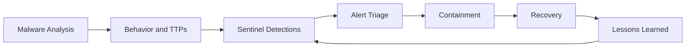

---

## 👤 About

| | |
|---|---|
| **Author** | Anas Mateen|
| **Repo** | [github.com/xxx/xx](https://github.com/xxx/xx) |
| **Email** |  |
| **LinkedIn** |  |

Hands-on security projects focused on **Soc-Analyst work**: detection engineering in Microsoft Sentinel, incident response,

---

## 🗂️ Labs and Projects

| | Project | What it covers |
|:-:|---|---|
| 🛡️ | <a href="https://github.com/AnasMateen369/Detection-Lab">Detection-Lab</a> |Deployed the Splunk Universal Forwarder on a Windows target to capture and centralize Security Event Logs, specifically engineering alerts to detect Event ID 4625 (Failed Account Logins) for real-time brute-force threat identification.
|
| 🧬 | [**edr-project/**](/edr-project) | Custom Windows EDR prototype detecting in-memory process injection (hollowing, shellcode remote thread, image-based) using a kernel driver, user-mode hook DLL, and rules-based chain scoring. Includes a layered Authenticode trust subsystem (path + LOLBin denylist + embedded/catalog signature verification) for false-positive suppression. Validated against SnakeKeylogger and a Defender-evasive injection sample. |
| 🚨 | [**incident-response/**](/incident-response) | Case studies linking malware behavior, Sentinel detections, and analyst actions (triage → containment → recovery). |
| 🎣 | [**phishing-analysis/**](/phishing-analysis) | Triage of real phishing emails: header and `Received` chain analysis, SPF/DKIM/DMARC verdicts, URL and infrastructure assessment, IOC extraction, written verdicts and recommended actions. |
| 🦠 | [**malware-analysis/**](/malware-analysis) | Isolated lab for manual Windows malware analysis (ProcMon, Wireshark). Behaviors and TTPs documented per sample: SnakeKeylogger, Agent Tesla, Pulsar/Quasar RAT, WannaCry. |
| 🔍 | [**vulnerability-management-lab/**](/vulnerability-management-lab) | Nessus Essentials and OpenVAS (Greenbone): scanning, triage, validation, prioritization, remediation, verification. Featured finding takes one critical (an unauthenticated root backdoor) end to end: manual validation, root-cause analysis, verified fix, two-scanner comparison. |
| 🧱 | [**legacy-sentinel-lab/**](/legacy-sentinel-lab) | Foundational Microsoft Sentinel lab (architecture + detections). The associated IR case study lives in [**incident-response/**](/incident-response). |

---

## 🛡️ Detection Lab Breakdown

<b>Click to expand: detections included in <code>detection-lab/</code></b>

 

### 🏢 Active Directory (6 detections)

| Detection | MITRE ATT&CK |
|---|---|
| Password spray | T1110.003 |
| Kerberoasting | T1558.003 |
| AS-REP roasting | T1558.004 |
| DCSync | T1003.006 |
| Privileged group changes | T1098 |
| GPO abuse | T1484.001 |

### 🔐 Okta Identity (4 detections)

| Detection | MITRE ATT&CK |
|---|---|
| Password spray | T1110.003 |
| MFA fatigue | T1621 |
| Admin role grant | T1098.003 |
| Policy tampering | T1562 |

### ☁️ Entra ID (3 detections)

| Detection | MITRE ATT&CK |
|---|---|
| Privileged role grant | T1098.003 |
| Credential added to an app | T1098.001 |
| OAuth permission grant | T1528 |

### 🦠 Extras
- Malware behavior detections built from, and validated against, samples from my own malware analysis
- Sentinel → Velociraptor automated response playbook

---

## 🔄 Workflow Across Projects

---

## 🧰 Tech Stack

| Category | Tools |
|---|---|
| **SIEM / XDR** | Microsoft Sentinel, Splunk, Elastic Security, Defender XDR |
| **Query languages** | KQL, SPL, Sigma |
| **Endpoint / DFIR** | Sysmon, Velociraptor, Hayabusa, Chainsaw, EvtxECmd |
| **Network** | Wireshark, Zeek, Suricata |
| **Malware analysis** | ProcMon, Any.run, Hybrid Analysis, VirusTotal, CyberChef |
| **Vuln management** | Nessus Essentials, OpenVAS (Greenbone) |
| **Identity** | Active Directory, Entra ID,|

---

## 📜 License

Released into the public domain under **The Unlicense**.

